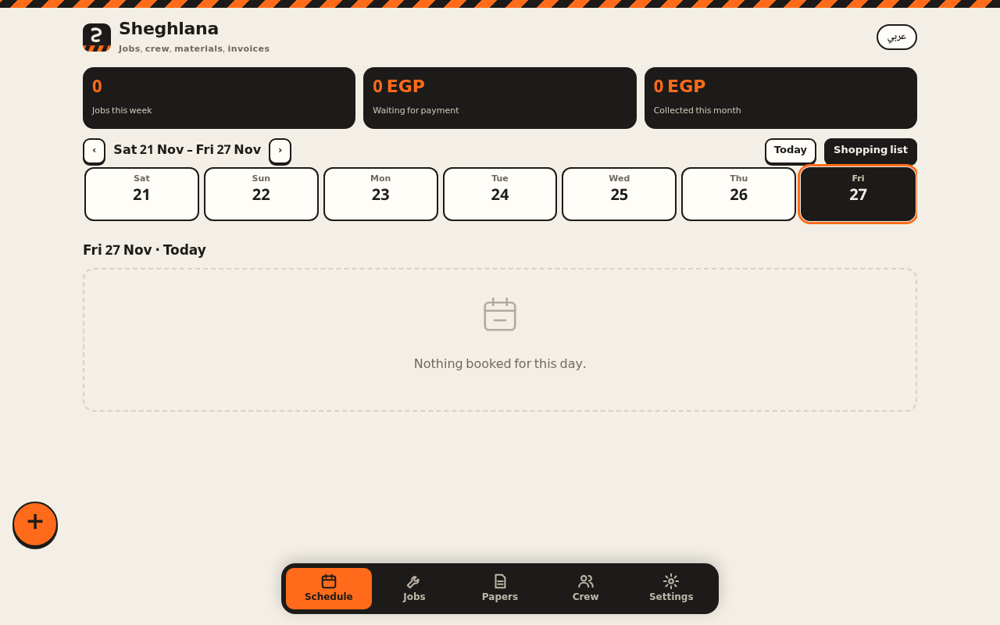
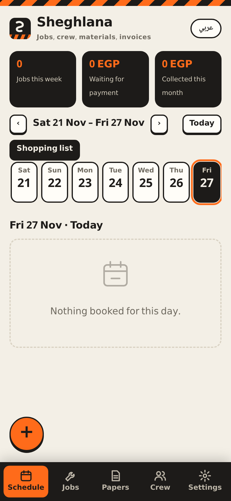
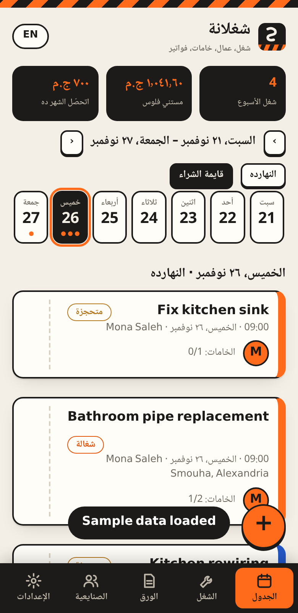
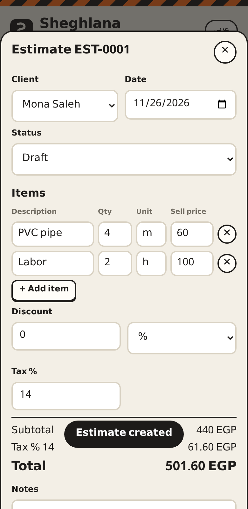
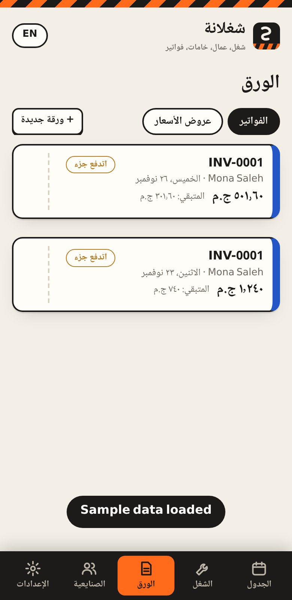
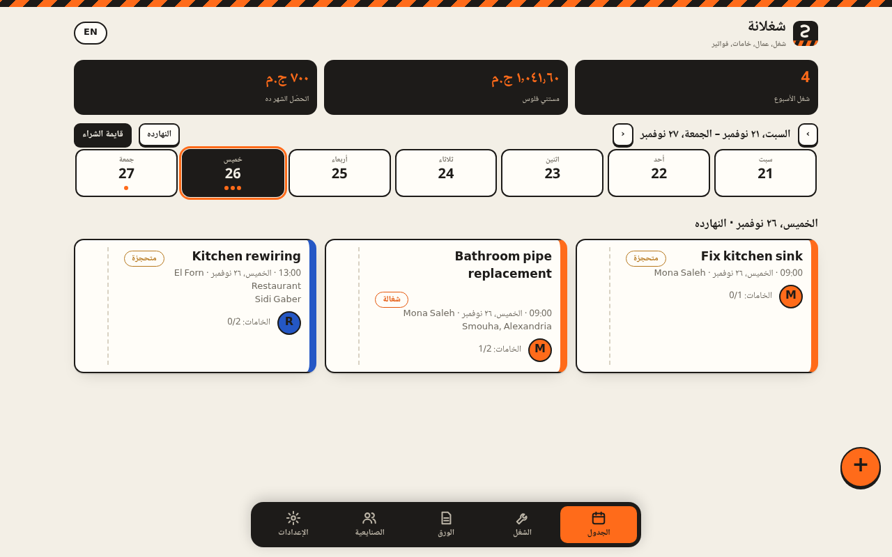

<p align="center"></p>

<h1 align="center">Sheghlana | شغلانة</h1>

<p align="center"><b>A job book for tradesmen: schedule the work, track materials, assign the crew, and turn an estimate into an invoice.</b><br>
Plumbers, electricians, painters, carpenters, AC techs. Arabic and English, right-to-left, built for a phone.</p>

<p align="center"><a href="https://yousefkhames.github.io/sheghlana/"><b>Open the live demo</b></a></p>

## Screenshots

Captured from the live site (https://yousefkhames.github.io/sheghlana/).

<p>
  
  
</p>

## The problem

A tradesman runs the business from WhatsApp, a notebook and memory. Who is on which job today? Did we buy the pipes? What did we quote Mrs. Mona? Who still owes money? Sheghlana puts those answers on one screen.

## Screenshots

| Schedule (Arabic, RTL) | Estimate (English) | Papers (Arabic) |
|---|---|---|
|  |  |  |



## Features

- **Week schedule**: pick a day, see the jobs, see who is on each one. Week starts on Saturday by default.
- **Jobs**: client, address, time, duration, status, crew, labor hours and rate, notes. One tap to call the client or open the address in a map.
- **Double-booking warning** when a worker is already on another job at an overlapping time.
- **Materials per job** with your cost and your sell price, a bought checkbox, and a quick pick from your own catalog. Live revenue, cost and profit per job.
- **Weekly shopping list**: all materials you still need to buy for the week, merged across jobs.
- **Estimates and invoices**: build them from a job in one tap (materials plus a labor line), add a discount (percent or fixed) and tax, and print or save as PDF.
- **Estimate to invoice**: one button copies the estimate into a numbered invoice (INV-0001, ...) and marks the estimate accepted.
- **Payments**: record part payments, see the balance, and see overdue invoices.
- **Send on WhatsApp**: opens WhatsApp with the quote or invoice as a text message.
- **Crew, clients, catalog**, backup and restore as JSON, invoices export as CSV.
- Arabic (Egyptian) and English, RTL and LTR, installable as a home-screen app, works offline after the first visit.

## Tech

Plain HTML, CSS and JavaScript. No framework, no build step, no server, no tracking. The business logic (totals, tax, discounts, numbering, conflicts, shopping list) lives in `logic.js` as pure functions with unit tests. Data is stored in your browser's `localStorage`.

## Tests

```
node tests/logic.test.js          # 13 unit tests for the logic
NODE_PATH=<puppeteer-core> node tests/e2e.js <url>   # 21 click-through checks in real Chrome
```

The click-through test adds a worker, client and catalog item, books a job, checks the totals, triggers the double-booking warning, creates an estimate, adds tax, converts it to an invoice, records a payment, reloads to check persistence, opens the shopping list and print view, flips to Arabic and checks RTL and mobile overflow.

## Honest limits

- This is a demo hosted on GitHub Pages, not a production service.
- Data lives in one browser on one device. There is no account, no sync between phone and laptop, and clearing browser data erases it. Use the backup export.
- There is no login, so do not treat it as secure storage for sensitive client data.
- WhatsApp sending opens WhatsApp with a ready message. It does not send automatically.
- Invoice numbers and tax follow the simple settings here. It is not a tax-authority e-invoice and does not replace an accountant.

## Run it

Open `index.html`, or serve the folder with any static server (`python3 -m http.server`).

## License

MIT, see [LICENSE](LICENSE).

## Demo / portfolio project

Static GitHub Pages site. Data stays in your browser (localStorage). There is no backend, no sync between devices and no payment. Invoices and estimates are demo documents, not a certified invoicing or tax system. "Send on WhatsApp" opens a draft; you send it yourself.

By Yousef Khames · من تطوير يوسف خميس

## Review notes (AUDIT.md)

See [AUDIT.md](AUDIT.md) for findings, fixes and remaining risks. Run `node tests/logic.test.js` (20 tests).
