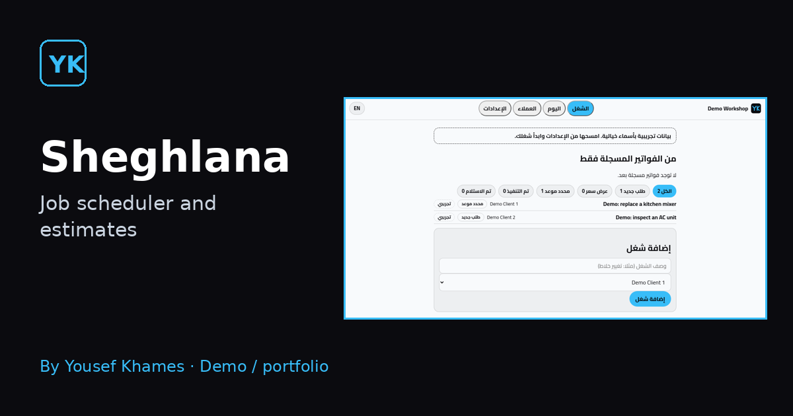

<div align="center">


# sheghlana

**sheghlana** · demo / portfolio project

**جدولة شغل وعروض أسعار** · مشروع تجريبي للعرض

[Live demo](https://yousefkhames.github.io/sheghlana/) · By Yousef Khames · من تطوير يوسف خميس



</div>

---

# sheghlana · شغلانة

A white-label job, estimate and invoice tracker for tradespeople: plumbers, electricians, painters and AC technicians. Clients, jobs with status, a day list, estimate and invoice builder with print or PDF and a WhatsApp draft, notes and checklist, a manual "payment received" mark, and CSV and JSON export. Arabic RTL and English LTR. Static HTML, CSS and JavaScript. No build, account, server or payment processor.

<div lang="ar" dir="rtl">متابعة الشغل وعروض الأسعار والفواتير للصنايعية. البيانات تبقى في متصفحك فقط. بدون سيرفر وبدون دفع داخل التطبيق.</div>

 **By Yousef Khames · من تطوير يوسف خميس**

## Features

- Jobs: lead, estimate sent, scheduled, done, received. Filter by status. Notes, checklist, date and time.
- Day view: jobs for a chosen date, sorted by time.
- Estimate and invoice from line items (labour and materials). Print or save as PDF through the browser print dialog. WhatsApp draft with the number and total (the app only opens a draft).
- Numbering: prefix and next number are set in Settings. No legal format is assumed. A number is fixed once issued and never reused.
- Tax rate is set by the owner, default 0. It is copied onto the job when a document is issued, so later changes do not rewrite old documents.
- "Mark payment received" is a manual note (method and note). Nothing is paid or processed in the app.
- Totals (invoiced, received, outstanding) are computed from recorded invoices only; "No invoices recorded yet" is shown until one exists.
- CSV export of jobs (formula cells are neutralised), JSON backup and restore.

## Preview locally

```sh
python3 -m http.server 8080 --bind 127.0.0.1
```

Opens with fictional demo clients and jobs, labelled Demo. Settings → "Clear demo data" empties the app. Screenshots in `docs/` use demo data only.

## Configure

`config.js`: `demo: false` starts empty. Business name, phone, currency, tax and numbering are in Settings. Theme in `assets/kit-theme.js`. Keep `assets/yk-logo.svg` and `assets/favicon.svg`.

## Deploy (GitHub Pages)

Create `yousefkhames/sheghlana`, commit to `main`, Settings → Pages → Deploy from a branch → `main` / root. Live at `https://yousefkhames.github.io/sheghlana/`.

## Tests

```sh
npm test   # unit + review gates + headless Chrome e2e (Node 20+)
```

## Honest limits

- **Data lives in this browser on this device.** No sync, no accounts. Clearing site data erases it. Export a backup often.
- **Documents are not tax-authority documents.** They are not Egyptian e-invoices or e-receipts, and no tax registration data is included. They carry a line saying so.
- No payments in the app. The "received" mark is only what you type.
- **No photo attachments in this version.** Local photo storage can fill the browser storage quickly and lose data; add it only with an export plan.
- Prices and quantities are what you type; nothing is estimated for you.

## License

MIT, copyright Yousef Khames. See `LICENSE`. Cairo font: SIL OFL. `assets/qrcode.js`: qrcode-generator by Kazuhiko Arase (MIT).

> Demo / portfolio project. Static GitHub Pages site with fictional sample data, not a certified invoicing system.
